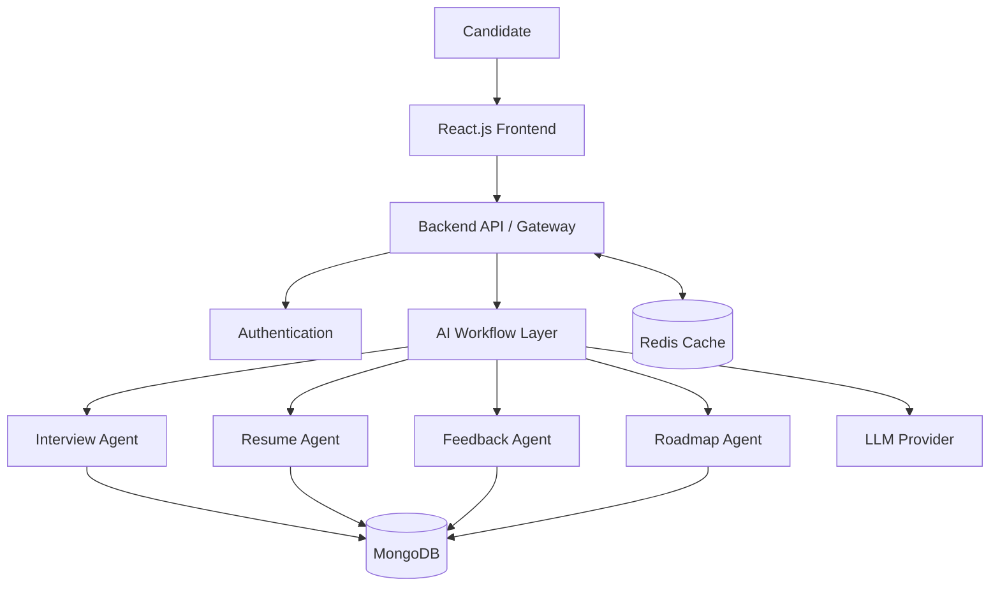

# IntervexaAI

```{=html}
<p align="center">
```
``{=html}
```{=html}
</p>
```
```{=html}
<h3 align="center">
```
Your AI-powered partner for smarter interview preparation.
```{=html}
</h3>
```
```{=html}
<p align="center">
```
Practice interviews, understand your strengths, improve your skills, and
build a personalised roadmap with a team of specialised AI agents.
```{=html}
</p>
```
```{=html}
<p align="center">
```
``{=html}
``{=html}
``{=html}
```{=html}
</p>
```

------------------------------------------------------------------------

## 📌 About

**IntervexaAI** is an AI-powered interview preparation platform designed
to help candidates prepare with confidence. It brings together multiple
specialised AI agents to support the complete preparation journey---from
resume analysis and realistic interview practice to actionable feedback
and personalised learning roadmaps.

The platform is being built with a modern, scalable architecture using
React, Node.js, LangChain, LangGraph, MongoDB, Redis, Docker, and AWS.

> **Project status:** IntervexaAI is under active development. Features,
> architecture, and screenshots may change as the project evolves.

## ✨ Key Features

  -----------------------------------------------------------------------
  Feature                             Description
  ----------------------------------- -----------------------------------
  🤖 **AI Interview Agent**           Conducts interactive, role-focused
                                      interview sessions and asks
                                      relevant follow-up questions.

  📄 **Resume Agent**                 Analyses uploaded resumes, extracts
                                      key information, and highlights
                                      strengths and improvement areas.

  📊 **AI Feedback Agent**            Reviews interview performance and
                                      provides structured, actionable
                                      feedback.

  🧭 **Roadmap Agent**                Creates personalised learning
                                      roadmaps based on a candidate's
                                      goals, skills, and resume.

  🔐 **Secure Authentication**        Supports secure sign-in with
                                      Firebase Authentication.

  📈 **Modern Dashboard**             Brings interviews, resume insights,
                                      feedback, and learning progress
                                      together.

  🧩 **Multi-Agent Workflows**        Uses specialised AI agents
                                      coordinated through modern AI
                                      workflow patterns.

  ⚡ **Redis Caching**                Supports faster access to
                                      frequently requested data and
                                      computationally expensive results.

  🐳 **Containerised Services**       Uses Docker to package services
                                      consistently across development and
                                      deployment environments.

  ☁️ **Cloud-ready Architecture**     Designed with scalable deployment
                                      on AWS in mind.
  -----------------------------------------------------------------------

## 🖼️ Screenshots

Screenshots will be added as the UI is finalised. Replace each
placeholder with your own image and update the paths if needed.

### Dashboard

```{=html}
<!-- Replace the placeholder below with your dashboard screenshot. -->
```
```{=html}
<p align="center">
```
``{=html}
```{=html}
</p>
```
### AI Interview

```{=html}
<!-- Replace the placeholder below with your AI interview screenshot. -->
```
```{=html}
<p align="center">
```
``{=html}
```{=html}
</p>
```
### Resume Analysis

```{=html}
<!-- Replace the placeholder below with your resume analysis screenshot. -->
```
```{=html}
<p align="center">
```
``{=html}
```{=html}
</p>
```
### Personalised Learning Roadmap

```{=html}
<!-- Replace the placeholder below with your roadmap screenshot. -->
```
```{=html}
<p align="center">
```
``{=html}
```{=html}
</p>
```
### Feedback Report

```{=html}
<!-- Replace the placeholder below with your feedback report screenshot. -->
```
```{=html}
<p align="center">
```
``{=html}
```{=html}
</p>
```
## 🛠️ Tech Stack

### Frontend

-   **React.js** --- component-based user interface
-   **JavaScript** --- application logic and interactions

### Backend & Data

-   **Node.js** --- JavaScript runtime
-   **Express.js** --- API and service layer
-   **MongoDB** --- persistent application data
-   **Redis** --- caching and fast data access

### AI & Agent Workflows

-   **LangChain** --- LLM integrations and agent building blocks
-   **LangGraph** --- stateful, multi-step AI workflows
-   **Specialised AI agents** --- interview, resume, feedback, and
    roadmap tasks

### Infrastructure & Authentication

-   **Docker** --- containerisation
-   **Microservices** --- independently organised application services
-   **Firebase Authentication** --- identity and sign-in
-   **AWS** --- cloud infrastructure and deployment target

## 🧠 How It Works

At a high level, IntervexaAI connects a candidate's goals and
preparation data to specialised AI workflows.

1.  **Sign in** securely to the platform.
2.  **Add a resume** (optional, depending on the workflow) so the
    platform can understand your experience and skills.
3.  **Practise an interview** with the AI Interview Agent.
4.  **Review feedback** generated from the interview and relevant
    candidate context.
5.  **Build a learning plan** with the Roadmap Agent to focus on the
    next skills to improve.



*Illustrative high-level view. The final service boundaries and data
flows may evolve during development.*

## 🏗️ Architecture Goals

IntervexaAI is being developed with the following engineering goals:

-   **Separation of concerns:** keep frontend, API, AI workflows, and
    data responsibilities clearly organised.
-   **Independent services:** structure backend capabilities so services
    can be developed and scaled independently where appropriate.
-   **Reliable AI workflows:** use explicit workflow states, validation,
    and error handling for multi-step agent tasks.
-   **Performance:** use Redis selectively for caching suitable data and
    expensive repeat operations.
-   **Security:** validate inputs, protect authenticated routes, manage
    secrets through environment variables, and apply least-privilege
    access.
-   **Deployment consistency:** use Docker to make service environments
    reproducible.
-   **Observability:** build toward structured logs, health checks, and
    service-level monitoring.

## 🚀 Getting Started

The exact setup commands may change as the repository structure is
finalised. The following is a starting point; adjust paths and scripts
to match your implementation.

### Prerequisites

-   Node.js (LTS recommended)
-   npm
-   MongoDB
-   Redis
-   Docker and Docker Compose (for containerised development)
-   Firebase project credentials
-   API credentials for your selected LLM provider

### Installation

``` bash
# Clone the repository
git clone https://github.com/yeasin-riyad/Multi-Agent-Ai-Platform-Microservices-Architecture.git

# Enter the project directory
cd intervexaAI
```

Install dependencies in the relevant frontend and backend directories.
For example:

``` bash
cd frontend
npm install

cd ../backend
npm install
```

### Environment Variables

Create `.env` files in the relevant services. Do not commit real
credentials.

Example backend environment configuration (update variable names to
match your code):

``` env
PORT=8000
NODE_ENV=development

MONGODB_URI=mongodb://127.0.0.1:27017/intervexaai
REDIS_URL=redis://localhost:6379

FRONTEND_URL=http://localhost:5173

# Firebase Admin configuration
FIREBASE_PROJECT_ID=
FIREBASE_CLIENT_EMAIL=
FIREBASE_PRIVATE_KEY=

# LLM provider
GROQ_API_KEY=
# Add other provider keys only if your implementation uses them.
```

Example frontend environment configuration:

``` env
VITE_API_BASE_URL=http://localhost:8000

# Add Firebase web configuration using your project's actual variable names.
VITE_FIREBASE_API_KEY=
VITE_FIREBASE_AUTH_DOMAIN=
VITE_FIREBASE_PROJECT_ID=
VITE_FIREBASE_APP_ID=
```

> Keep `.env` files, private keys, service-account JSON files, and API
> tokens out of version control. Add them to `.gitignore`. Never expose
> server-side secrets through frontend environment variables.

### Run Locally

Start MongoDB and Redis, then run each application service using its own
development script. Example:

``` bash
# Terminal 1 — backend
cd backend
npm run dev

# Terminal 2 — frontend
cd frontend
npm run dev
```

If your project uses Docker Compose, start the configured services with:

``` bash
docker compose up --build
```

The commands above are illustrative. Use the actual service directories
and scripts defined in your repository.

## 🗂️ Suggested Repository Structure

This is an example structure for a multi-service implementation, not a
claim about the current repository layout.

``` text
intervexaAI/
├── frontend/
│   ├── src/
│   │   ├── components/
│   │   ├── features/
│   │   ├── pages/
│   │   └── services/
│   └── package.json
│
├── backend/
│   ├── src/
│   │   ├── config/
│   │   ├── controllers/
│   │   ├── middleware/
│   │   ├── models/
│   │   ├── routes/
│   │   ├── services/
│   │   └── server.js
│   └── package.json
│
├── services/
│   ├── interview-agent/
│   ├── resume-agent/
│   ├── feedback-agent/
│   └── roadmap-agent/
│
├── docs/
│   ├── assets/
│   └── screenshots/
│
├── docker-compose.yml
├── .gitignore
└── README.md
```

## 🔒 Security Notes

-   Never commit `.env` files, Firebase service-account credentials, or
    API keys.
-   Verify Firebase ID tokens on the server before trusting
    authenticated user information.
-   Validate and sanitise incoming request data.
-   Apply authorisation checks to user-owned resources.
-   Configure CORS with explicitly trusted frontend origins.
-   Use secure, HTTP-only cookies where cookie-based sessions are used.
-   Apply upload size limits and validate file type and content for
    resume uploads.
-   Add rate limiting and sensible request timeouts to public APIs.
-   Avoid logging passwords, tokens, private keys, or sensitive resume
    content.

## 🧪 Testing

Testing coverage will be documented as the project test suites are
added. Recommended areas include:

-   Authentication and authorisation
-   API request validation and error handling
-   Resume upload and parsing
-   Agent workflow state transitions
-   Interview session lifecycle
-   Feedback and roadmap generation
-   Redis cache behaviour and invalidation
-   Service health checks and integration flows

## 🗺️ Roadmap

-   [x] Define the core product concept and technology stack
-   [ ] Complete authentication and user management
-   [ ] Build the AI Interview Agent workflow
-   [ ] Build resume upload and analysis
-   [ ] Generate structured interview feedback
-   [ ] Generate personalised learning roadmaps
-   [ ] Complete dashboard and progress views
-   [ ] Add comprehensive automated tests
-   [ ] Containerise services with Docker Compose
-   [ ] Configure production deployment on AWS
-   [ ] Add monitoring, logging, and performance metrics

## 🤝 Contributing

Contributions, suggestions, and bug reports are welcome.

1.  Fork the repository.
2.  Create a feature branch: `git checkout -b feature/your-feature`.
3.  Commit your changes: `git commit -m "feat: add your feature"`.
4.  Push your branch: `git push origin feature/your-feature`.
5.  Open a pull request with a clear description of the changes.

Please avoid including secrets, personal data, or production credentials
in issues and pull requests.

## 📄 License

No license has been specified yet. All rights are reserved by default
until a license is added to this repository. If you intend to make the
project open source, add a `LICENSE` file with the license you choose.

## 👨‍💻 Author

**Your Name**

-   GitHub: [@your-username](https://github.com/yeasin-riyad)
-   LinkedIn: [Your LinkedIn](linkedin.com/in/mdyeasinmazumder)

------------------------------------------------------------------------

```{=html}
<p align="center">
```
Built with ❤️ to make interview preparation smarter with AI.
```{=html}
</p>
```
