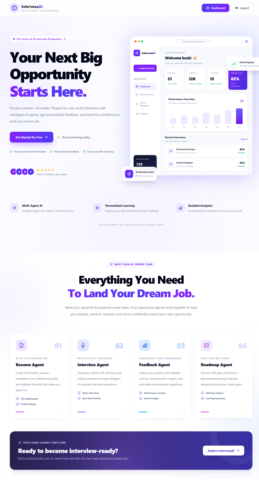
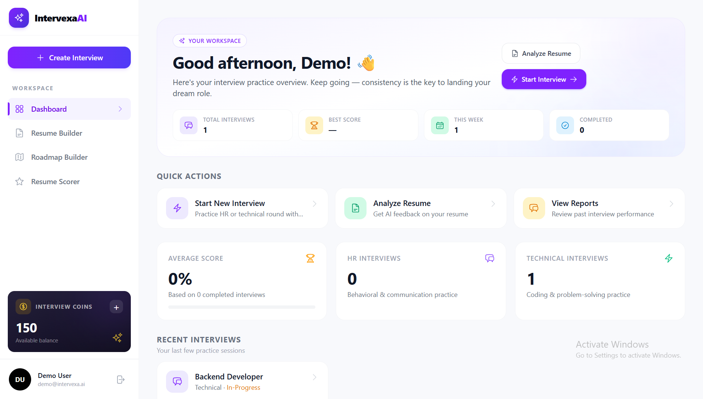
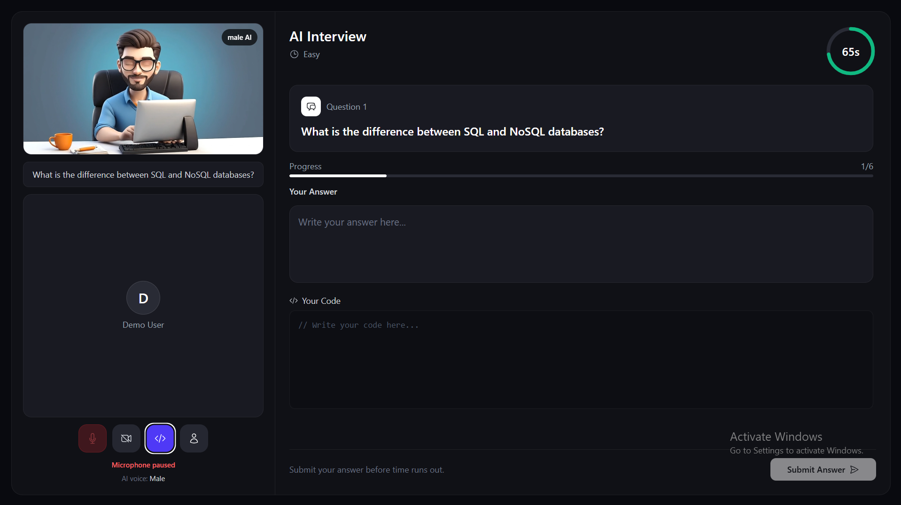
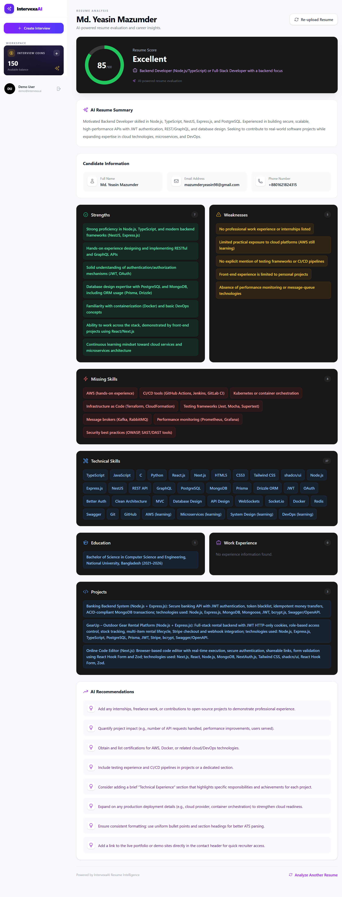
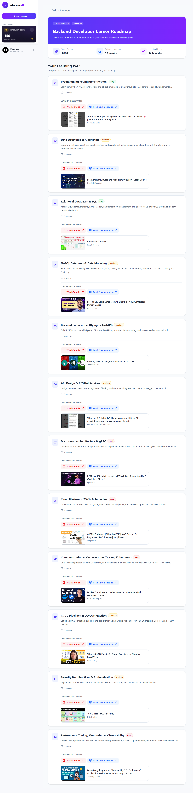
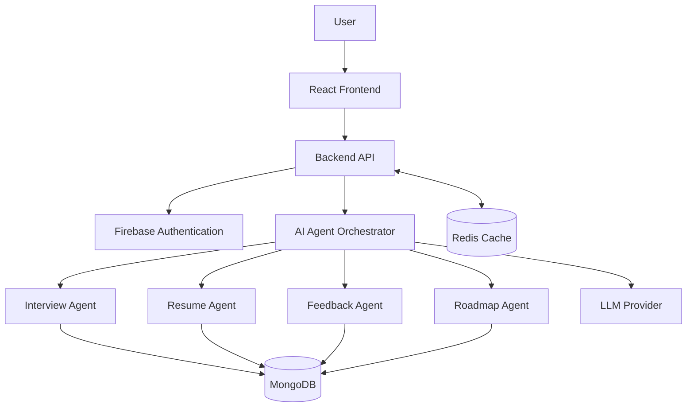

<div align="center">

  

  # IntervexaAI

  ### AI-Powered Interview Preparation Platform

  **Prepare Smarter. Practice Better. Get Hired.**

  An intelligent interview preparation platform powered by multiple specialised AI agents. Analyse resumes, conduct realistic interviews, receive personalised feedback, and build learning roadmaps.

  
  
  

</div>

---

## 📌 About IntervexaAI

**IntervexaAI** is a modern AI-powered interview preparation platform designed to help developers and job seekers improve their technical interview skills.

The platform uses multiple specialised AI agents to automate and personalise the interview preparation process.

Instead of relying on a single AI assistant, IntervexaAI uses dedicated agents for different responsibilities, including interview conduction, resume analysis, performance evaluation, and personalised learning roadmap generation.

Our goal is to make interview preparation smarter, more personalised, and more accessible.

## ✨ Features

### 🤖 AI Interview Agent
- Conducts interactive AI-powered interviews.
- Generates role-specific interview questions.
- Asks dynamic follow-up questions.
- Evaluates candidate responses.
- Supports realistic interview experiences.

### 📄 Resume Agent
- Upload and analyse resumes.
- Extract relevant candidate information.
- Identify technical skills and experience.
- Analyse strengths and weaknesses.
- Provide resume improvement suggestions.

### 📊 AI Feedback Agent
- Analyses interview performance.
- Evaluates technical responses.
- Identifies strengths and weaknesses.
- Generates personalised improvement suggestions.
- Provides actionable performance feedback.

### 🧭 Roadmap Agent
- Generates personalised learning roadmaps.
- Identifies missing technical skills.
- Creates structured learning plans.
- Recommends topics to improve.
- Helps candidates achieve career goals.

### 🔐 Authentication
- Secure authentication with Firebase.
- Protected application routes.
- User-specific data management.

### 📈 Modern Dashboard
- Centralised dashboard.
- Interview history.
- Resume analysis reports.
- Performance insights.
- Learning roadmap tracking.

### ⚡ Infrastructure
- Multi-agent AI architecture.
- Scalable backend services.
- Redis caching.
- Dockerised services.
- Cloud-ready architecture using AWS.

---

## 🖼️ Screenshots

> Screenshots are placeholders. Replace them with actual application screenshots when available.

### Home Page

<p align="center">
  
</p>

### Dashboard

<p align="center">
  
</p>

### AI Interview

<p align="center">
  
</p>

### Resume Analysis

<p align="center">
  
</p>

### Learning Roadmap

<p align="center">
  
</p>

### AI Feedback

<p align="center">
  
</p>

---

## 🛠️ Technology Stack

| Technology | Purpose |
|---|---|
| React.js | Frontend development |
| Node.js | Backend runtime |
| Express.js | REST API development |
| MongoDB | Database |
| Redis | Caching |
| LangChain | AI application development |
| LangGraph | Multi-agent workflows |
| Firebase Authentication | User authentication |
| Docker | Containerisation |
| Microservices | Distributed architecture |
| AWS | Cloud infrastructure |

---

## 🧠 AI Multi-Agent Architecture

IntervexaAI uses specialised AI agents to handle different interview preparation tasks.

Each agent has its own responsibility and can participate in a larger AI workflow.

### Agent Responsibilities

| Agent | Responsibility |
|---|---|
| Interview Agent | Conducts AI-powered interviews |
| Resume Agent | Analyses uploaded resumes |
| Feedback Agent | Evaluates interview performance |
| Roadmap Agent | Generates personalised learning plans |

### System Architecture



---

## 🔄 Application Workflow

1. User creates an account or signs in.
2. User uploads a resume (optional).
3. Resume Agent analyses the candidate's profile.
4. Interview Agent conducts a personalised interview.
5. Feedback Agent evaluates the interview.
6. Roadmap Agent generates a personalised learning roadmap.
7. User tracks preparation progress through the dashboard.

---

## 🏗️ Project Architecture

IntervexaAI follows a modular architecture designed for maintainability and scalability.

```text
IntervexaAI/
│
├── frontend/
│   ├── src/
│   │   ├── components/
│   │   ├── features/
│   │   ├── pages/
│   │   ├── hooks/
│   │   └── services/
│   │
│   └── package.json
│
├── backend/
│   ├── src/
│   │   ├── config/
│   │   ├── controllers/
│   │   ├── middleware/
│   │   ├── models/
│   │   ├── routes/
│   │   ├── services/
│   │   └── server.js
│   │
│   └── package.json
│
├── services/
│   ├── interview-agent/
│   ├── resume-agent/
│   ├── feedback-agent/
│   └── roadmap-agent/
│
├── docs/
│   └── screenshots/
│
├── docker-compose.yml
├── .gitignore
└── README.md
```

*This is a suggested structure; adjust it to match the actual repository.*

---

## 🚀 Getting Started

Follow these instructions to run the project locally.

### Prerequisites

Make sure you have installed:

- Node.js
- npm
- MongoDB
- Redis
- Docker (optional)
- Firebase Project
- LLM Provider API Key

### 1. Clone Repository

```bash
git clone https://github.com/yeasin-riyad/Multi-Agent-Ai-Platform-Microservices-Architecture.git

cd Multi-Agent-Ai-Platform-Microservices-Architecture
```

### 2. Install Dependencies

Frontend:

```bash
cd frontend
npm install
```

Backend:

```bash
cd backend
npm install
```

### 3. Configure Environment Variables

Create a `.env` file inside the backend directory.

```env
PORT=8000
NODE_ENV=development

MONGODB_URI=mongodb://127.0.0.1:27017/intervexaai

REDIS_URL=redis://localhost:6379

FRONTEND_URL=http://localhost:5173

# Firebase Admin
FIREBASE_PROJECT_ID=
FIREBASE_CLIENT_EMAIL=
FIREBASE_PRIVATE_KEY=

# AI Provider
GROQ_API_KEY=
```

Create a frontend `.env` file:

```env
VITE_API_BASE_URL=http://localhost:8000

VITE_FIREBASE_API_KEY=
VITE_FIREBASE_AUTH_DOMAIN=
VITE_FIREBASE_PROJECT_ID=
VITE_FIREBASE_APP_ID=
```

**Important:** Never commit your `.env` files, Firebase service account credentials, or API keys to GitHub.

### 4. Run Backend

```bash
cd backend
npm run dev
```

### 5. Run Frontend

Open another terminal:

```bash
cd frontend
npm run dev
```

### 6. Run with Docker

If Docker Compose is configured:

```bash
docker compose up --build
```

---

## 🔒 Security

IntervexaAI aims to follow modern application security practices:

- Firebase token verification.
- Protected API endpoints.
- Secure HTTP-only authentication cookies where applicable.
- Environment-based secret management.
- Input validation and sanitisation.
- Resume upload validation.
- CORS configuration.
- User-level resource authorisation.
- API rate limiting.

---

## 🗺️ Development Roadmap

- [x] Project concept and technology selection
- [ ] Secure authentication system
- [ ] AI Interview Agent
- [ ] Resume Agent
- [ ] AI Feedback Agent
- [ ] Personalised Roadmap Agent
- [ ] Modern dashboard
- [ ] Redis caching integration
- [ ] Docker integration
- [ ] Microservices deployment
- [ ] AWS deployment
- [ ] Monitoring and logging
- [ ] Automated testing

---

## 🤝 Contributing

Contributions, suggestions, and improvements are welcome!

1. Fork the repository.
2. Create a new branch.

```bash
git checkout -b feature/your-feature
```

3. Commit your changes.

```bash
git commit -m "feat: add new feature"
```

4. Push your branch.

```bash
git push origin feature/your-feature
```

5. Open a Pull Request.

---

## 📄 License

A license has not yet been specified for this project. All rights remain reserved until a license is added.

---

## 👨‍💻 Author

**Yeasin Mazumder**

- GitHub: [@yeasin-riyad](https://github.com/yeasin-riyad)
- LinkedIn: [Yeasin Mazumder](https://www.linkedin.com/in/mdyeasinmazumder)

---

<div align="center">

  ### ⭐ Support IntervexaAI

  If you find this project interesting, consider giving it a star!

  **Built with ❤️ and AI to make interview preparation smarter.**

</div>
